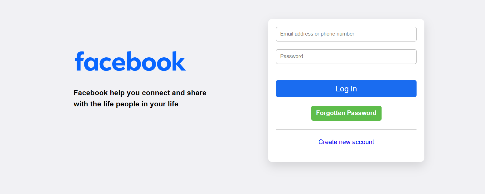

# 🔐 Facebook Login Page

### Task Session 9 | Front-End Development Course – Creativa

A Facebook Login Page UI recreation developed as **Task Session 9** during my Front-End Development Course at **Creativa**.

---

## 📸 Project Preview

  

---

## 📝 About The Project

This project is a recreation of the Facebook Login Page interface, developed as part of the practical assignments in **Session 9 of the Front-End Development Course at Creativa**.

The main goal was to practice HTML forms and CSS styling techniques while recreating a familiar web interface.

## 🛠️ Technologies Used

  
  

## 🎯 Concepts Practiced

- HTML5 page structure.
- Creating HTML forms and input fields.
- Input attributes: `required`, `name`, and `placeholder`.
- Styling links and form elements.
- CSS Float and Clear.
- Box Shadow and Border Radius.
- CSS Focus State using `:focus`.
- CSS Selectors, including `:nth-of-type()`.

## 🚀 Live Demo

[View Facebook Login Page](https://basmala-amr-7.github.io/task_session_9/)

---

## 📚 Course Information

- **Course:** Front-End Development
- **Training Provider:** Creativa
- **Task:** Session 9
- **Project Type:** Practical Assignment

---

## ⚠️ Note

This project is a front-end UI recreation for educational purposes. It does not implement real user authentication or connect to Facebook's login system.

---

**Made with HTML & CSS**

